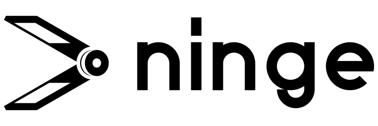

<!-- Korean translation of README.md (approved). README.md is canonical; change both together. -->

<div align="center">

<h1 align="center">
  <picture>
    <source media="(prefers-color-scheme: dark)" srcset="docs/logo/ninge-lockup-white.svg">
    
  </picture>
</h1>

**Rust로 처음부터 만든, 터미널 네이티브 듀얼 스크린 휴대용 게임기 에뮬레이터**

[](https://github.com/devgyurak/ninge/actions/workflows/ci.yml)
[](LICENSE)
[](rust-toolchain.toml)
[](#실행)
[](https://github.com/devgyurak/ninge/commits/develop)

[현재 상태](#현재-상태) · [설치](#설치) · [실행](#실행) · [문서](#문서) · [기여](#기여) ·
[English](README.md)

</div>

**ninge**("닌지"라고 읽습니다. 두 화면을 잇는 경첩, *hinge*를 비튼 이름입니다)는 Nintendo
DS 호환 휴대용 게임기를 터미널 안에서 에뮬레이션합니다. 두 화면을 kitty 그래픽 프로토콜로
그리기 때문에 **Ghostty와 kitty**에서만 동작합니다. 코어는 직접 만들었고 다른 에뮬레이터의
코드는 들어 있지 않으며, BIOS나 펌웨어 덤프 없이 부팅합니다.

## 현재 상태

ninge는 초기 단계입니다. 작업은 [`docs/PLAN.md`](docs/PLAN.md)의 단계(phase)를 따르고, 지금
단계는 [`docs/STATUS.md`](docs/STATUS.md)에 있습니다.

| 지금 되는 것 | 아직 안 되는 것 |
|---|---|
| 두 CPU(ARMv5TE, ARMv4T)와 결정적(deterministic) 이벤트 스케줄러 | 사운드: 레지스터는 응답하지만 소리는 나지 않음 |
| 두 화면의 2D: 배경, 스프라이트, 윈도우, 블렌딩, 디스플레이 캡처 | 3D: 지오메트리 명령은 받지만 아무것도 그리지 않음 |
| 키보드, 게임패드, 마우스 입력과 터치스크린, 마이크, 덮개 | 성능 작업: 마지막 단계에서 진행 |
| 카트리지 읽기, 세이브 칩(EEPROM, FLASH, FRAM)과 세이브 파일 | 디버거 |
| 실시간 시계(호스트 시계에 맞춤) | 두 화면을 위아래로 놓는 것 외의 레이아웃 |
| HLE BIOS 호출, 직접 부팅, 합성 펌웨어: 덤프 불필요 | |

이 표는 `develop` 브랜치 기준입니다. 배포된 릴리스는 이보다 오래됐을 수 있으며, 릴리스별로
되는 것과 안 되는 것은 [`docs/release-notes/`](docs/release-notes/)에 있습니다.

## 설치

Rust가 필요합니다. CI는 [`rust-toolchain.toml`](rust-toolchain.toml)에 고정한 버전을
씁니다. 0.1.0부터는 crates.io에서 설치할 수 있습니다.

```sh
cargo install ninge
```

저장소를 클론했다면:

```sh
cargo install --locked --path crates/frontend
```

macOS(Apple Silicon 우선)와 Linux를 지원하고, Windows는 지원 예정입니다. Linux에서는 게임패드
지원을 빌드하려면 libudev 헤더가 필요하므로 `libudev-dev`와 `pkg-config`(Debian·Ubuntu 패키지
이름)를 먼저 설치하세요.

## 실행

Ghostty나 kitty를 열고:

```sh
ninge path/to/program.nds   # ROM 실행
ninge                       # ROM 없음: 테스트 패턴 표시
```

`Ctrl-C`나 `Ctrl-Q`로 종료합니다. ninge로는 직접 빌드한 홈브루처럼 실행할 권리가 있는
프로그램을 실행합니다. ninge는 ROM을 포함하지 않으며 BIOS나 펌웨어 파일도 필요하지 않습니다.

| 본체 | 키보드 | 게임패드 |
|---|---|---|
| 십자 키 | 방향키 | 십자 키 또는 왼쪽 스틱 |
| A, B | `X`, `Z` | 오른쪽, 아래쪽 버튼(표기가 아니라 위치 기준) |
| X, Y | `S`, `A` | 위쪽, 왼쪽 버튼 |
| L, R | `Q`, `W` | 숄더 버튼 |
| Start, Select | Enter, Backspace | Start, Select |
| 터치스크린 | 마우스: 왼쪽 버튼이 펜입니다. 또는 `Tab`으로 커서를 켜서 `h` `j` `k` `l`로 옮기고, Space로 누르고, `d`로 드래그를 켜고 끕니다 | |
| 마이크 | `M`을 누르고 있는 동안 마이크에 바람을 붑니다 | |
| 덮개 | `` ` ``로 닫고 엽니다 | |

카트리지의 세이브는 ROM 옆에 확장자가 `.sav`인 파일로 저장됩니다. `--save PATH`로 다른 파일을
지정하고, 세이브 칩 자동 감지가 틀릴 때는 `--save-type TYPE`으로 칩을 지정합니다.

## 빌드와 테스트

```sh
./scripts/verify.sh            # 전체 게이트: 설정 검사, fmt, clippy, 테스트, 90% 커버리지
./scripts/build_testroms.sh    # 직접 만든 테스트 ROM을 testroms/build/에 빌드 (Docker 필요)
```

테스트 ROM은 [`testroms/`](testroms/)에 있는 베어메탈 프로그램입니다. digest로 고정한
Docker 이미지의 [BlocksDS](https://blocksds.skylyrac.net/) SDK로 빌드하므로 `verify.sh`에는
[Docker](https://www.docker.com/)가 필요합니다. `ninge-runner`는 화면 없이 ROM을 돌리고 각
화면의 해시를 출력합니다.

```sh
cargo run -p ninge-runner -- testroms/build/smoke.nds --frames 3
# frames=3 top=<hash> bottom=<hash>
```

## 브랜치와 릴리스

`develop`과 `main`은 풀 리퀘스트로만 바뀌고, CI가 통과해야 합니다.

```
<prefix>/<summary>  ──PR──▶  develop  ──release PR──▶  main  ──tag vX.Y.Z──▶  crates.io
```

`develop`에서 딴 브랜치는 제목이 접두어(`ADD:`, `FIX:`, `REF:`, `DEL:`, `DOCS:`, `UPT:`)로
시작하는 PR로 머지됩니다. 릴리스는 버전을 올리는 `develop` → `main` PR과, 그 뒤 `main`에 다는
`vX.Y.Z` 태그로 이뤄집니다. 태그가
[`release.yml`](.github/workflows/release.yml)을 실행하면 메인테이너의 승인 후
`ninge-core`와 `ninge`를 crates.io에 배포하고,
[`docs/release-notes/`](docs/release-notes/)의 노트로 GitHub Release를 만듭니다.
`ninge-runner`와 `ninge-tracediff`는 저장소용 도구라 배포하지 않습니다.

## 클린룸

- 상용 ROM, 세이브, BIOS나 펌웨어 덤프, 또는 거기서 추출한 어떤 것도 이 저장소에 없습니다.
  직접 만든 테스트 ROM의 빌드 결과물조차 넣지 않습니다. 테스트는
  [`testroms/`](testroms/)에서 빌드한 프로그램만 씁니다.
- 하드웨어 동작은 주로 GBATEK을 바탕으로 우리 자신의 표현으로 쓴 [`docs/hw/`](docs/hw/)의
  노트에서 구현합니다. 확실하지 않은 동작은 추측하지 않고 미확인(unverified)으로 표시합니다.
- 다른 에뮬레이터의 코드는 복사하거나 이식·번역하지 않습니다. 참조 에뮬레이터의 릴리스 바이너리는
  블랙박스 오라클로만 씁니다.

전체 규칙은 [`AGENTS.md`](AGENTS.md) §3에 있습니다.

## 저장소 구조

```
crates/core/       ninge-core       에뮬레이터: 순수 로직, IO 없음
crates/frontend/   ninge            TUI와 `ninge` 바이너리
crates/runner/     ninge-runner     헤드리스 러너: 테스트, 트레이스, 골든 프레임
crates/tracediff/  ninge-tracediff  참조 에뮬레이터와의 트레이스 비교
testroms/          직접 만든 베어메탈 테스트 ROM 소스
tests/             통합 테스트, 골든 프레임 해시
docs/hw/           자체 표현으로 쓴 하드웨어 노트
docs/              계획, 현재 상태, 릴리스 노트, 로고
scripts/           verify.sh, 테스트 ROM 빌드, 에이전트 훅
AGENTS.md          모든 코딩 에이전트와 기여자를 위한 프로젝트 규칙
```

## 문서

| 문서 | 내용 |
|---|---|
| [`docs/PLAN-KO.md`](docs/PLAN-KO.md) ([English](docs/PLAN.md)) | 목표, 아키텍처, 단계별 로드맵([§5](docs/PLAN-KO.md#5-로드맵)), 레퍼런스([§9](docs/PLAN-KO.md#9-레퍼런스)) |
| [`docs/STATUS.md`](docs/STATUS.md) | 현재 단계, 단계별 완료 조건, 확정된 결정 |
| [`docs/release-notes/`](docs/release-notes/) | 릴리스마다 되는 것과 안 되는 것 |
| [`docs/hw/`](docs/hw/README.md) | 자체 표현으로 쓴 하드웨어 노트: 클린룸의 경계 |
| [`AGENTS.md`](AGENTS.md) | 아키텍처 규칙([§2](AGENTS.md#2-architecture--never-violate)), 클린룸([§3](AGENTS.md#3-clean-room-and-legal-invariants--the-most-dangerous-part)), 테스트([§5](AGENTS.md#5-tests--enforced-rules)) |
| [`testroms/README.md`](testroms/README.md) | 테스트 ROM 각각과 그것이 확인하는 것 |
| [`tests/golden/README.md`](tests/golden/README.md) | 골든 프레임 해시를 만드는 법과 바꿀 수 있는 때 |
| [`decision` 라벨 이슈](https://github.com/devgyurak/ninge/issues?q=label%3Adecision) | 맥락과 대안을 함께 남긴 설계 결정 |

## 기여

먼저 [`AGENTS.md`](AGENTS.md)를 읽어 주세요. 아키텍처 규칙, 클린룸 규칙, 테스트 규칙이 모두
여기에 있고, 풀 리퀘스트 전에 `./scripts/verify.sh`가 통과해야 합니다. 풀 리퀘스트는
`develop`으로 보냅니다.

## 라이선스

[Apache License 2.0](LICENSE).

ninge는 Nintendo와 제휴하지 않았으며, Nintendo의 보증이나 후원을 받지 않습니다. Nintendo DS는
Nintendo의 상표이며, 여기서는 ninge가 어떤 하드웨어와 호환되는지 밝히는 데에만 씁니다.
